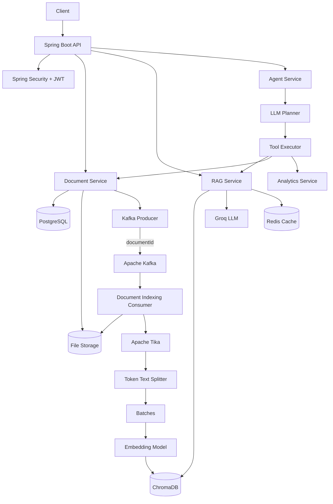
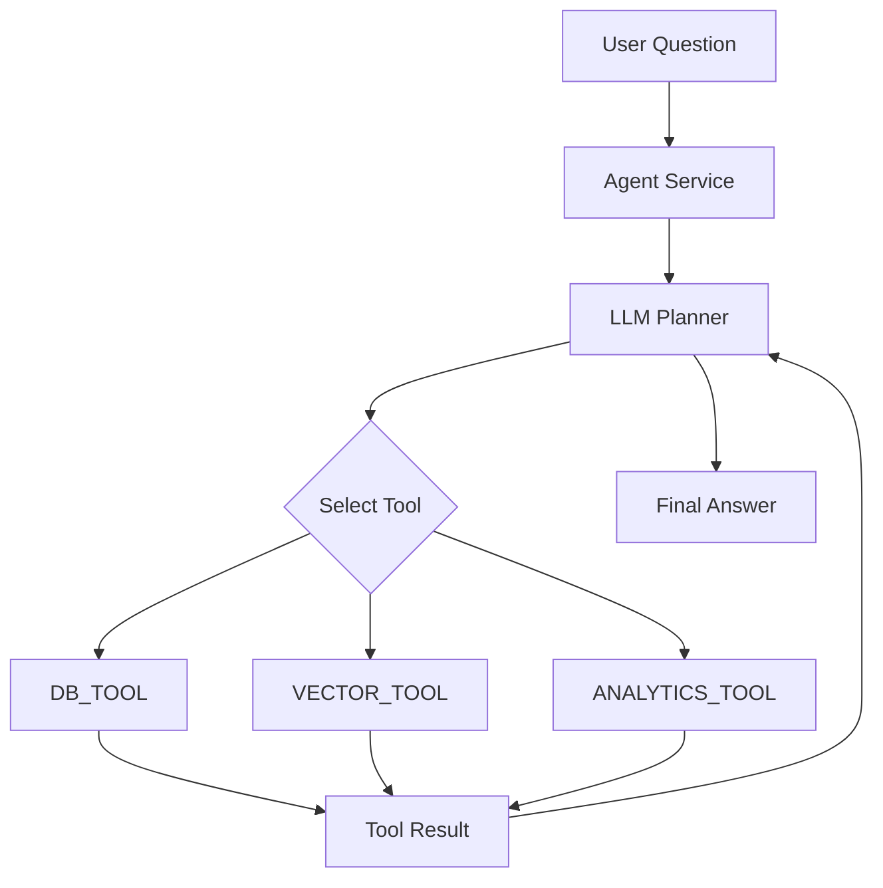

# AI Knowledge Assistant

An AI-powered knowledge assistant built with **Java, Spring Boot, Spring AI, Apache Kafka, Redis, PostgreSQL, ChromaDB, and JWT authentication**.

The system allows authenticated users to upload documents, asynchronously process and index their contents into a vector database, and ask natural-language questions using a **Retrieval-Augmented Generation (RAG)** pipeline.

The project also includes an **experimental agentic layer** where an LLM planner can select between different backend tools for document retrieval, vector search, and analytics operations.

---

## 🚀 Highlights

* 🔐 JWT-based authentication with BCrypt password hashing
* 👤 Per-user document isolation in retrieval, caching, and deletion
* 📄 Document upload with raw files kept in pluggable storage (local disk now, S3-ready)
* ⚡ Asynchronous document indexing using Apache Kafka, with ID-only messages
* 🧩 Token-based chunking, embedded in retryable batches with progress tracking
* 🔎 Semantic vector search using ChromaDB
* 🤖 RAG-based question answering using Spring AI
* 🧠 Groq-powered LLM integration
* 🗄️ PostgreSQL for persistent application data
* ⚡ Redis caching for repeated RAG queries
* 🛡️ Resilience4j retry and circuit-breaker patterns
* 📊 Spring Boot Actuator for health and metrics
* 🧪 Experimental LLM-based agent/tool selection
* ✅ Unit tests with JUnit 5 and Mockito that run without any infrastructure
* 🐳 Docker Compose-based local infrastructure

---

# 🏗️ Architecture



---

# 🔄 How It Works

## 1. Authentication

Users register and authenticate through the authentication API.

Passwords are hashed using **BCrypt**, and successful authentication returns a JWT token.

Protected endpoints require a valid JWT and the application uses stateless Spring Security configuration.

```text
Client
   |
   v
Register / Login
   |
   v
Spring Security
   |
   v
BCrypt Password Hashing
   |
   v
JWT Token
   |
   v
Protected APIs
```

---

# 📄 2. Document Upload

Authenticated users can upload documents through the document API.

The backend:

1. Receives the uploaded document.
2. Stores document metadata in PostgreSQL with a `PENDING` indexing state.
3. Saves the raw file to document storage.
4. Publishes an indexing event to Kafka containing only the document ID.

No parsing happens during the request, so large or slow-to-parse files don't hold up the upload. If the file can't be stored, the metadata row is removed again rather than left behind.

```text
Document Upload
       |
       v
 PostgreSQL (PENDING)
       |
       v
 Document Storage  (data/uploads/{id})
       |
       v
 Kafka Producer  {"documentId": 42}
       |
       v
 document-indexing topic
```

Storage sits behind a `DocumentStorage` interface. The current implementation writes to local disk; an object-storage implementation such as S3 can replace it without changing the upload or indexing code.

---

# ⚡ 3. Asynchronous Document Indexing

Kafka is used to decouple document ingestion from vector indexing.

The indexing consumer processes documents asynchronously.

```text
Kafka Consumer  {"documentId": 42}
      |
      v
Load file from Document Storage
      |
      v
Text Extraction (Apache Tika, no length limit)
      |
      v
TokenTextSplitter (~500-token chunks, no chunk cap)
      |
      v
Batches of 100 chunks
      |
      v
Embedding Model (Ollama) --> ChromaDB      (per batch, with retries)
```

Key properties of the pipeline:

* **Whole documents are indexed.** Tika's default 100,000-character limit and the splitter's chunk cap are both removed, so long documents are no longer cut short.
* **Batches with progress.** Chunks are embedded and stored in batches (`indexing.batch-size`), and the document records `batchesDone` / `batchesTotal`, visible in the document list.
* **Per-batch retries.** A failing batch is retried (`indexing.batch-max-attempts`, with backoff) without redoing earlier batches.
* **Deterministic chunk IDs.** Each chunk is stored as `{documentId}:{chunkIndex}`. ChromaDB upserts by ID, so a retried batch overwrites its chunks instead of duplicating them.
* **Failure reasons.** A document that fails indexing is marked `FAILED` with an `errorMessage` such as `Batch 2/10 failed after 3 attempts: ...`.
* **Deletes during indexing are safe.** If a document is deleted while being indexed, the consumer removes any chunks it stored in the meantime and stops.

The document indexing lifecycle is represented by:

```text
PENDING
   |
   v
INDEXING
   |
   v
INDEXED
```

If indexing fails, the document can enter the:

```text
FAILED
```

state.

### Why Kafka?

Document processing can involve:

* Text extraction
* Chunking
* Embedding generation
* Vector database operations

Moving this work to an asynchronous consumer prevents these operations from being tightly coupled to the document upload request.

### Why only the document ID goes through Kafka

Kafka is designed for small messages and rejects messages over about 1 MB by default, while uploads can be up to 10 MB. Instead of putting document text in the message, the file is kept in storage and the message carries only its ID (the *claim-check* pattern). Messages stay a few bytes regardless of document size, and the same message shape works when the trigger later becomes an object-storage event.

---

# 🧠 4. Retrieval-Augmented Generation

When a user asks a question, the RAG pipeline performs semantic retrieval before generating an answer.

```text
User Question
      |
      v
Vector Similarity Search
      |
      v
Retrieve Top 5 Chunks
      |
      v
Build Context
      |
      v
Context + Question
      |
      v
LLM
      |
      v
Grounded Answer
      |
      v
Sources
```

The application retrieves the five most relevant document chunks from ChromaDB.

The search is **filtered to the requesting user's own documents**: every chunk carries an `uploadedBy` metadata field, and the similarity search only considers chunks where it matches the authenticated user. One user's documents never feed another user's answers.

If no matching chunks are found, the API returns a message asking the user to upload documents, without calling the LLM.

These chunks are combined into a context that is supplied to the language model.

The system prompt instructs the model to:

* Answer using the supplied context.
* Avoid unsupported assumptions.
* Indicate when the requested information is not available in the uploaded documents.

The response also contains the filenames used as sources.

---

# ⚡ 5. Redis Query Caching

Repeated RAG queries can result in unnecessary LLM requests.

The application therefore uses **Redis** to cache RAG responses.

The query is normalized using:

```java
question.toLowerCase().trim()
```

The cache key combines the user's email with the normalized question (`email:question`), so cached answers are never shared between users.

Answers without sources (no matching documents, or the fallback reply when the LLM is unavailable) are not cached, so they don't persist after a user uploads a document or the LLM recovers. Cached entries expire after 30 minutes, and deleting a document clears the cache.

```text
User Question
      |
      v
Normalize Query
      |
      v
Redis Cache
   /       \
 HIT       MISS
  |          |
  v          v
Return     RAG Pipeline
Answer        |
              v
          LLM Response
              |
              v
          Redis Cache
```

This avoids repeatedly calling the external LLM provider for identical queries.

---

# 🛡️ 6. Resilience

External AI services are treated as unreliable external dependencies.

The application uses **Resilience4j** to provide:

* Retry
* Circuit Breaker
* Fallback handling

```text
RAG Service
     |
     v
External LLM
     |
     +---- Failure ----+
     |                 |
     v                 v
   Retry         Circuit Breaker
                       |
                       v
                   Fallback
```

The circuit breaker can temporarily prevent additional calls when the failure threshold is reached.

If retries are exhausted or the circuit is open, the application returns a controlled fallback response instead of allowing the external failure to propagate uncontrolled through the application.

Document indexing has its own resilience: each batch of chunks is retried independently with backoff, and a document that still fails is marked `FAILED` with the reason recorded.

---

# 🤖 7. Experimental Agentic Layer

The project also contains an experimental agent architecture.

An LLM-based planner determines which tool should handle a request.

Currently available tools include:

| Tool             | Purpose                               |
| ---------------- | ------------------------------------- |
| `DB_TOOL`        | Retrieve document-related information |
| `VECTOR_TOOL`    | Perform vector/RAG-related operations |
| `ANALYTICS_TOOL` | Perform analytics operations          |

The planner produces a structured decision similar to:

```json
{
  "tool": "VECTOR_TOOL",
  "input": "Find information about supplier costs"
}
```

The `AgentService` executes the selected tool and can feed the result back into the planner.

The agent is restricted to a maximum of **3 execution steps**.

### Agent Flow



> **Note:** The agent/tool layer is experimental. The tool implementations are currently placeholders that return fixed data, and they are not yet scoped to the requesting user.

---

# 🔐 Security

The application uses Spring Security with JWT-based stateless authentication.

### Security components

* Spring Security
* JWT
* BCrypt
* Stateless authentication
* Protected API endpoints

Authentication flow:

```text
Username + Password
        |
        v
Authentication
        |
        v
BCrypt Verification
        |
        v
JWT Token
        |
        v
Authorization Header
        |
        v
Protected API
```

### Document ownership

* Every document and every stored chunk is tagged with the uploader's email.
* Vector search, cached answers, and the document list are all scoped to the authenticated user.
* Deleting another user's document returns `403 Forbidden`; deleting a non-existent document returns `404 Not Found`.

Secrets and API credentials are kept in a gitignored local configuration file or environment variables rather than committed to the repository (see [Configure Secrets](#3-configure-secrets)).

---

# 🧩 Key Features

| Feature             | Technology            |
| ------------------- | --------------------- |
| Backend API         | Spring Boot           |
| Authentication      | Spring Security + JWT |
| Password Hashing    | BCrypt                |
| Document Processing | Apache Tika           |
| File Storage        | Local disk (S3-ready) |
| Async Processing    | Apache Kafka          |
| Text Chunking       | TokenTextSplitter     |
| Vector Database     | ChromaDB              |
| LLM Integration     | Spring AI + Groq      |
| Embeddings          | Ollama                |
| Relational Database | PostgreSQL            |
| Caching             | Redis                 |
| Resilience          | Resilience4j          |
| Monitoring          | Spring Boot Actuator  |
| Testing             | JUnit 5 + Mockito     |
| Build               | Maven                 |
| Infrastructure      | Docker Compose        |

---

# 🛠️ Technology Stack

## Backend

* Java 17
* Spring Boot 3.2
* Spring Web
* Spring Security
* Spring Data JPA
* Hibernate
* Spring AI

## AI / RAG

* Spring AI
* Groq (`openai/gpt-oss-120b`)
* Ollama (`nomic-embed-text` embeddings)
* ChromaDB
* Vector similarity search
* TokenTextSplitter

## Messaging

* Apache Kafka
* Zookeeper

## Data

* PostgreSQL
* Redis
* ChromaDB

## Security

* Spring Security
* JWT
* BCrypt

## Resilience & Observability

* Resilience4j
* Spring Boot Actuator
* Logback
* Logstash Encoder

## Testing

* JUnit 5
* Mockito
* AssertJ

## Build & Infrastructure

* Maven
* Docker
* Docker Compose

---

# 📁 Project Structure

```text
ai-knowledge-assistant/
│
├── docker-compose.yml
│
├── backend/
│   └── ai-knowledge-assistant/
│       │
│       ├── pom.xml
│       ├── data/uploads/   (gitignored, uploaded files)
│       │
│       └── src/
│           ├── main/
│           │   ├── java/
│           │   │   └── com/ai_knowledge_assistant/
│           │   │
│           │   └── resources/
│           │       ├── application.yaml
│           │       └── application-local.yaml   (gitignored, your secrets)
│           │
│           └── test/
│
├── .gitignore
├── mvnw
├── mvnw.cmd
└── README.md
```

The backend is organized around functional areas:

```text
auth/
document/
storage/
kafka/
rag/
agent/
analytics/
query/
config/
exception/
```

---

# 🚀 Running Locally

## Prerequisites

Install the following:

* Java 17
* Maven
* Docker
* Docker Compose
* Ollama

You will also need a Groq API key.

Pull the embedding model once:

```bash
ollama pull nomic-embed-text
```

---

## 1. Clone the Repository

```bash
git clone https://github.com/mayankgz/ai-knowledge-assistant.git

cd ai-knowledge-assistant
```

---

## 2. Start Infrastructure

From the project root:

```bash
docker compose up -d
```

This starts:

* PostgreSQL
* Redis
* Kafka
* Zookeeper
* ChromaDB

---

## 3. Configure Secrets

Do **not** commit API keys, passwords, JWT secrets, or other credentials to GitHub.

`application.yaml` keeps blank placeholders and automatically imports an optional, gitignored `application-local.yaml`. Create it at `backend/ai-knowledge-assistant/src/main/resources/application-local.yaml`:

```yaml
spring:
  ai:
    openai:
      api-key: <your-groq-api-key>

jwt:
  secret: <base64-secret>
```

* `jwt` is a top-level key, not nested under `spring`.
* The JWT secret is Base64-decoded and used for HS256, so it must be at least 256 bits. Generate one with `openssl rand -base64 64`.

Alternatively, any property can be supplied as an environment variable, for example:

```bash
SPRING_AI_OPENAI_API_KEY=<your-groq-api-key>
JWT_SECRET=<base64-secret>
```

---

## 4. Start the Backend

Navigate to the backend directory:

```bash
cd backend/ai-knowledge-assistant
```

Run:

```bash
./mvnw spring-boot:run
```

On Windows:

```bash
mvnw.cmd spring-boot:run
```

---

## 5. Run the Tests

Unit tests use mocks and need no Docker, Ollama, or API keys:

```bash
./mvnw test
```

Run a single test class or method:

```bash
./mvnw test -Dtest=RagServiceTest
./mvnw test -Dtest=RagServiceTest#searchIsFilteredToTheRequestingUser
```

The full-application context test is skipped by default because it needs all infrastructure running:

```bash
INTEGRATION_TESTS=true ./mvnw test
```

---

# 🔌 API Overview

## Authentication

### Register

```http
POST /api/v1/auth/register
```

### Login

```http
POST /api/v1/auth/login
```

The login response provides a JWT token that must be supplied when accessing protected endpoints.

---

## Documents

### Upload Document

```http
POST /api/v1/documents
```

Multipart parameter:

```text
file
```

Returns `201 Created` with the document in `PENDING` state. Indexing happens in the background.

### List Documents

```http
GET /api/v1/documents
```

Returns the authenticated user's documents, including indexing progress:

```json
{
  "id": 42,
  "filename": "report.pdf",
  "status": "INDEXING",
  "batchesDone": 4,
  "batchesTotal": 10,
  "errorMessage": null
}
```

### Delete Document

```http
DELETE /api/v1/documents/{id}
```

Removes the document's chunks from ChromaDB, its stored file, and its database record. Returns `204`, `403` for another user's document, or `404` if it doesn't exist.

---

## Query

### Ask a Question

```http
POST /api/v1/query
```

Parameter:

```text
question
```

Answers are drawn only from the authenticated user's own documents.

Example:

```text
What caused the increase in supplier costs?
```

Example response:

```json
{
  "answer": "...",
  "sources": [
    "example.pdf"
  ]
}
```

---

## Agent

The experimental agent endpoint is:

```http
GET /api/v1/agent
```

Parameter:

```text
question
```

The planner determines which available tool should handle the request.

---

# 💡 Design Decisions

## Why Kafka?

Document indexing involves potentially expensive processing such as:

* Text extraction
* Chunking
* Embedding generation
* Vector storage

Kafka allows this processing to happen asynchronously instead of blocking the document upload request.

---

## Why store files and batch the indexing?

Passing document text through Kafka limits document size to Kafka's message limit and couples the queue to the payload. Storing the file and sending only its ID keeps messages tiny and mirrors how object-storage pipelines work (an upload to S3 triggering an event that carries the object key).

Splitting chunks into batches makes indexing large documents robust: a failure costs one batch instead of the whole document, progress is visible, and the same batch unit can later be fanned out to parallel workers. Deterministic chunk IDs make retries safe.

---

## Why ChromaDB?

The application needs semantic retrieval over document chunks.

ChromaDB provides the vector storage and similarity-search layer required by the RAG pipeline.

---

## Why Redis?

Repeated questions can produce the same response.

Redis provides a cache layer that reduces unnecessary calls to the external LLM service.

---

## Why Resilience4j?

The LLM provider is an external dependency.

Retry and circuit-breaker patterns help isolate the application from temporary failures in the external AI service.

---

## Why JWT?

The application uses stateless authentication.

JWT allows protected APIs to validate the authenticated user without maintaining server-side HTTP sessions.

---

# 📈 Engineering Concepts Demonstrated

This project was designed to explore practical backend engineering concepts beyond basic CRUD APIs.

### Distributed Systems

* Asynchronous processing
* Event-driven architecture
* Kafka producers and consumers
* Claim-check pattern (ID-only messages, payload in storage)
* Batch processing with per-batch retries and progress tracking
* Idempotent writes through deterministic IDs
* External service failure handling

### Backend Architecture

* Layered Spring Boot architecture
* Feature-based package organization
* Service/repository separation
* Storage abstraction behind an interface
* Centralized exception handling with typed 403/404 responses
* Unit testing with mocks

### AI Engineering

* Retrieval-Augmented Generation
* Vector databases
* Embeddings
* Semantic search
* Prompt-based grounding
* LLM tool selection

### Performance

* Redis caching
* Asynchronous document processing
* Vector retrieval

### Reliability

* Retry
* Circuit breaker
* Fallback
* External dependency isolation

### Security

* JWT authentication
* BCrypt password hashing
* Stateless Spring Security
* Per-user data isolation in a shared vector store

---

# ⚠️ Current Limitations

This is a **learning and portfolio project rather than a production deployment**.

Current areas for improvement include:

* Kafka-level retry and dead-letter handling (failed documents are marked `FAILED` with a reason, but are not automatically retried)
* A re-index endpoint for previously uploaded documents
* Per-user cache invalidation (deleting a document currently clears all cached answers, and new uploads don't refresh cached answers until they expire)
* Local-disk file storage assumes a single application instance
* Integration tests against real infrastructure (current tests are unit tests with mocks)
* External secret management for production deployments
* Real agent/tool implementations scoped to the requesting user
* More complete analytics functionality
* OpenAPI/Swagger documentation
* Improved observability and distributed tracing
* Containerized application deployment
* Rate limiting for external LLM calls

---

# 🔮 Future Improvements

Planned improvements include:

* [x] Per-user document isolation in retrieval, caching, and deletion
* [x] Full-length document indexing with batched, retryable embedding
* [x] Unit test suite for the core services
* [ ] S3 storage with presigned and multipart uploads
* [ ] Parallel embedding workers (one queue message per batch)
* [ ] Streaming LLM responses
* [ ] Conversation/session memory
* [ ] Richer document metadata filtering
* [ ] Persistent analytics tools
* [ ] Additional document formats
* [ ] Role-based access control
* [ ] RAG evaluation metrics
* [ ] Automated integration tests
* [ ] AWS deployment
* [ ] CI/CD pipeline
* [ ] OpenTelemetry-based distributed tracing
* [ ] Improved Kafka retry and dead-letter handling

---

# 🎯 What This Project Demonstrates

The primary goal of this project is to demonstrate how a modern **Java/Spring Boot backend** can integrate AI capabilities while maintaining conventional backend engineering practices.

The system combines:

```text
Spring Boot
     +
Spring Security
     +
Kafka
     +
PostgreSQL
     +
Redis
     +
Vector Database
     +
LLM
     +
RAG
     +
Resilience Patterns
```

rather than treating the LLM as an isolated feature.

---

# 👨‍💻 Author

## Mayank Gagneja

Backend Software Engineer specializing in:

* Java
* Spring Boot
* Distributed Systems
* Kafka
* Redis
* PostgreSQL
* AWS
* AI / RAG

### Connect

**LinkedIn:**
[linkedin.com/in/mayank-gagneja](https://www.linkedin.com/in/mayank-gagneja)

**GitHub:**
[github.com/mayankgz](https://github.com/mayankgz)

---

⭐ If you find this project useful, feel free to explore the repository and the other backend projects on my GitHub.
